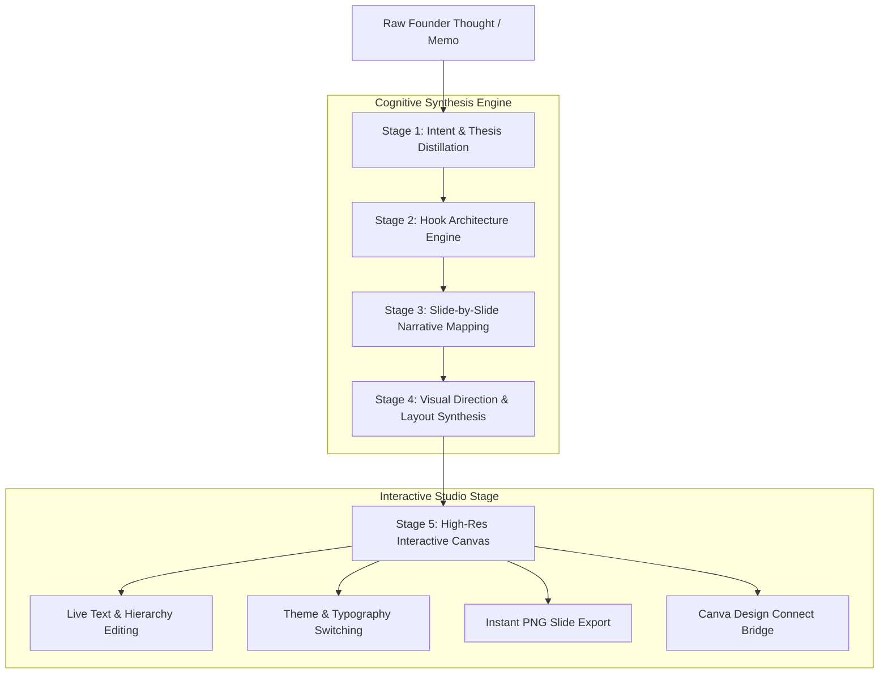

# AI Content Automation & Studio Production Workflow

## 1. System Overview

The AI Content Studio ("FounderForge") automates the translation of unstructured founder thoughts, voice notes, or thesis memos into high-impact social slide carousels for LinkedIn and Instagram.

Unlike trivial wrapper tools that output repetitive bullet points, FounderForge implements a **5-stage cognitive pipeline** grounded in editorial copywriting frameworks (The Hook-Problem-Framework-Action-Resolution sequence).

---

## 2. Multi-Stage Pipeline Diagram

---

## 3. Cognitive Pipeline Breakdown

### Stage 1: Intent & Thesis Distillation
- Analyzes the raw input for the core contrarian insight or tactical lesson.
- Strips fluff, corporate jargon, and passive phrasing.
- Identifies the target platform formatting rules:
  - **LinkedIn**: 1080x1080 (1:1) or 1200x1500 (4:5 document PDF). Emphasizes intellectual rigor, metric comparisons, and framework teardowns.
  - **Instagram**: 1080x1350 (4:5 portrait). Prioritizes bold typographic punches, high-contrast imagery notes, and immediate swipe curiosity.

### Stage 2: Hook Architecture Engine
- Generates 3 candidate hooks testing different psychological levers:
  1. *Contrarian Challenge* (e.g. "Everything founders are told about Series A is outdated.")
  2. *Quantitative Revelation* (e.g. "We analyzed 240 bootstrapped companies. Only 4% used this metric.")
  3. *Empathetic Pain Point* (e.g. "Why your 60-hour engineering sprint feels like running on a treadmill.")

### Stage 3: Slide-by-Slide Narrative Mapping
- Distributes the argument across 5, 7, or 10 slides:
  - **Slide 1**: Hook & Thesis
  - **Slide 2**: The Conventional Flaw / Cost of Inaction
  - **Slide 3**: The Underlying Mechanism (The "Why")
  - **Slide 4-6**: The 3-Step Execution Blueprint
  - **Slide N-1**: Summary Cheat-Sheet
  - **Slide N**: Founder Signature & Call to Action

### Stage 4: Visual Direction & Layout Synthesis
- Allocates typographic weights, line-heights, and visual pacing.
- Assigns specific visual cues (e.g. "accent badge on metric", "horizontal divider", "author watermark in bottom-right").

### Stage 5: Canvas Rendering & Export
- **Instant Client-Side PNG Rendering**: Directly renders the HTML/CSS DOM node of any slide onto an HTML5 `<canvas>` at $2\times$ pixel density ($2160 \times 2700$), exporting crystal-clear PNG files with zero watermarks.
- **Canva Integration Architecture**: Outlines a direct OAuth2 + Canva Connect API schema for dispatching generated slide layouts into Canva user folders for deep graphic refinement.
